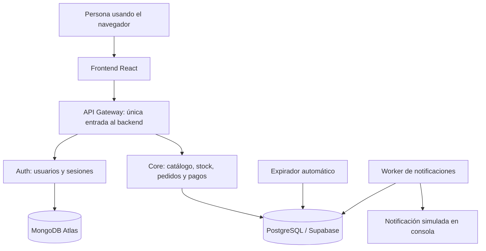
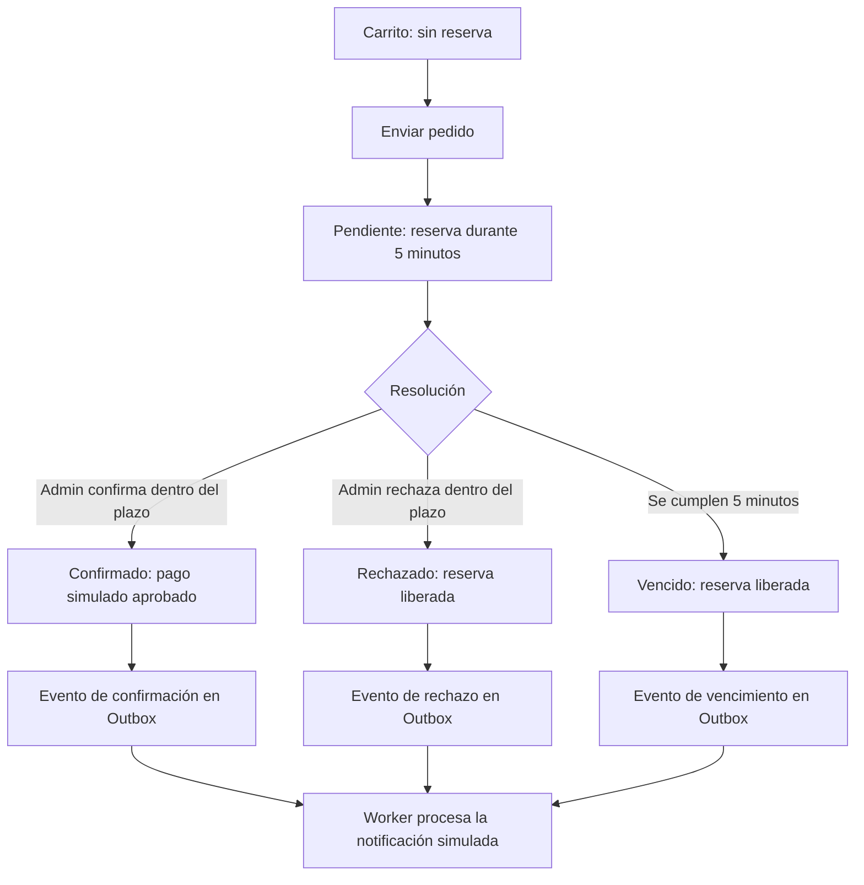

# Acordes Mayorista

MVP académico de una tienda de instrumentos musicales para clientes particulares y mayoristas. Demuestra una arquitectura orientada a servicios y cómo evitar sobreventa, resolver pedidos de forma segura y procesar eventos sin duplicar operaciones.

Esta guía explica el funcionamiento general. Para instalar, integrar, modificar o revisar el código, consultar la [referencia técnica](docs/REFERENCIA-TECNICA.md). Son los dos documentos narrativos vigentes; los ejemplos de contratos JSON permanecen en `shared/contracts/core`.

## Qué funciona

- Registro/login con roles cliente, operador y administrador.
- Alta con CUIT y aprobación mayorista por un administrador.
- Catálogo con precios en ARS, búsqueda, categorías, disponibilidad e imágenes opcionales.
- Carrito persistente en el navegador y pedidos con reserva de stock.
- Panel de stock físico para operador/admin y administración de clientes exclusiva de admin.
- Gestión de pedidos: confirmar/rechazar mediante pago simulado, sin cobros reales.
- Vencimiento automático de reservas y procesamiento de notificaciones simuladas.
- Controles de concurrencia, pagos duplicados, permisos, trazabilidad y balanceo entre réplicas del Core.

## Cómo se conecta



Gateway verifica identidad y permisos. Auth administra exclusivamente usuarios; Core administra los datos del negocio. El navegador no se conecta directamente a las bases.

La SPA tiene una publicación en [Vercel](https://acordesmayorista-japp.vercel.app). El entorno de pruebas compartido usa Frontend local y backend Docker en una PC, con Atlas/Supabase como bases cloud. Publicar la SPA no vuelve público el backend local ni confirma que esa publicación esté conectada al backend actual. El diagrama muestra conexiones lógicas, no un despliegue cloud completo o separación física de servidores.

## Qué pasa con una compra



El carrito solo guarda una selección en el navegador. El plazo comienza cuando el backend acepta el pedido. Si otra compra modificó el inventario, el envío puede recibir un conflicto y requerir actualizar el catálogo.

El cliente ve el estado real del pedido recién enviado, actualizado cada cinco segundos mientras está pendiente. Admin tiene una tabla con todos los pedidos, productos, total, vencimiento y botones de confirmar/rechazar. Confirmar representa un pago aprobado simulado, no una aprobación comercial separada del pago.

El expirador revisa al iniciar y 30 segundos después de completar cada lote. Normalmente libera en la siguiente revisión, no exactamente en el segundo del vencimiento. Aunque el expirador todavía no haya pasado, el servidor no confirma un pedido vencido.

## Cómo se protege el stock

| Situación | Físico | Reservado | Disponible |
| --- | ---: | ---: | ---: |
| Antes del pedido | 10 | 0 | 10 |
| Cliente pide 3 | 10 | 3 | 7 |
| Admin confirma | 7 | 0 | 7 |
| O bien: rechaza o vence | 10 | 0 | 10 |

Cada cambio aumenta una versión. Una compra/ajuste con versión vieja recibe un conflicto en lugar de sobrescribir otra operación. Un pedido de varios productos se reserva completo o se revierte completo. Al rechazar se libera solo su reserva, sin restaurar una foto antigua del inventario.

## Pedido y evento tienen estados distintos

| Dato en Supabase | Estado tras aprobar y consumir |
| --- | --- |
| Pedido, `orders.orders` | `PAID` |
| Pago, `payments.payments` | `APPROVED` |
| Evento `ORDER_PAID`, `mq.outbox` | Primero `PENDING`; luego `PROCESSED` |

La confirmación guarda pedido, pago, stock y evento en una transacción. Un worker separado procesa después la notificación, al iniciar y cada cinco segundos. Un evento recién creado puede estar brevemente pendiente aunque el pedido ya esté confirmado.

La notificación es un registro de consola, no un correo real. Repetir una resolución o el mismo pago no debe duplicar el descuento de stock, el pago ni el evento de resolución.

## Abrir el entorno de pruebas

En una PC configurada con Docker Desktop, Node, dependencias y archivos privados, desde la raíz:

```powershell
docker compose -f docker-compose.cloud-check.yml config --quiet
docker compose -f docker-compose.cloud-check.yml build auth-service core-service api-gateway
docker compose -f docker-compose.cloud-check.yml up -d
```

En otra terminal:

```powershell
cd apps/web
$env:VITE_API_URL='http://127.0.0.1:4000'
$env:VITE_DEMO_MODE='false'
npm.cmd run dev -- --host 127.0.0.1 --port 3000 --strictPort
```

Abrir **http://localhost:3000**. Gateway queda en 127.0.0.1:4000; estos comandos no habilitan acceso desde otras PCs. Las operaciones impactan Atlas/Supabase de prueba. Al iniciar, expirador y worker también procesan pedidos vencidos y eventos pendientes anteriores.

Para cliente/admin simultáneos usar perfiles separados o ventana normal e InPrivate. Crear un pedido, confirmar otro, rechazar otro y dejar vencer otro; contrastar estados/stock en Supabase refrescando el Table Editor.

Al terminar, detener Vite con Ctrl+C, ejecutar el siguiente comando y cerrar Docker Desktop cuando no se necesite:

```powershell
docker compose -f docker-compose.cloud-check.yml down
```

No borra las bases cloud. La referencia técnica cubre instalación inicial, pruebas aisladas, consultas y diagnóstico.

## Evidencia y límites

Se ejecutaron 47 pruebas automáticas: 14 Auth, 12 Gateway y 21 Core. Cubren permisos, reservas, rollback, diez checkouts por una unidad, pagos firmados, duplicados, decisiones tardías y carreras con el expirador. Se compiló y recorrió en Edge confirmación/rechazo/vencimiento con persistencia. El worker continuo se probó en base aislada y consumió los dos eventos pendientes de prueba en Supabase.

El balanceo se demostró localmente con dos réplicas, caída y recuperación. No se acreditaron 250 usuarios, tiempos bajo esa carga ni disponibilidad del 99,5 %.

Pendientes: historial completo del cliente, certificado de Supabase, roles SQL restringidos del Plan, lint global, compatibilidad más amplia y ensayo/evidencia de defensa. No hay pasarela real, correo externo ni tarifas/mínimos mayoristas implementados. El backend sigue local.

El alcance proviene de los TP y el Plan Integral de Implementación y Trazabilidad del equipo. Esta documentación describe implementación y límites; no declara cumplimiento de todos los requisitos originales.

## Equipo

Diego Jofre: Gateway, infraestructura y trazabilidad. Julieta Ruppert: Auth, identidad y roles. Paz Sinner: Core, stock y pagos. Camila Borodij: Frontend e integración. Las correcciones se coordinan sobre los contratos compartidos.
