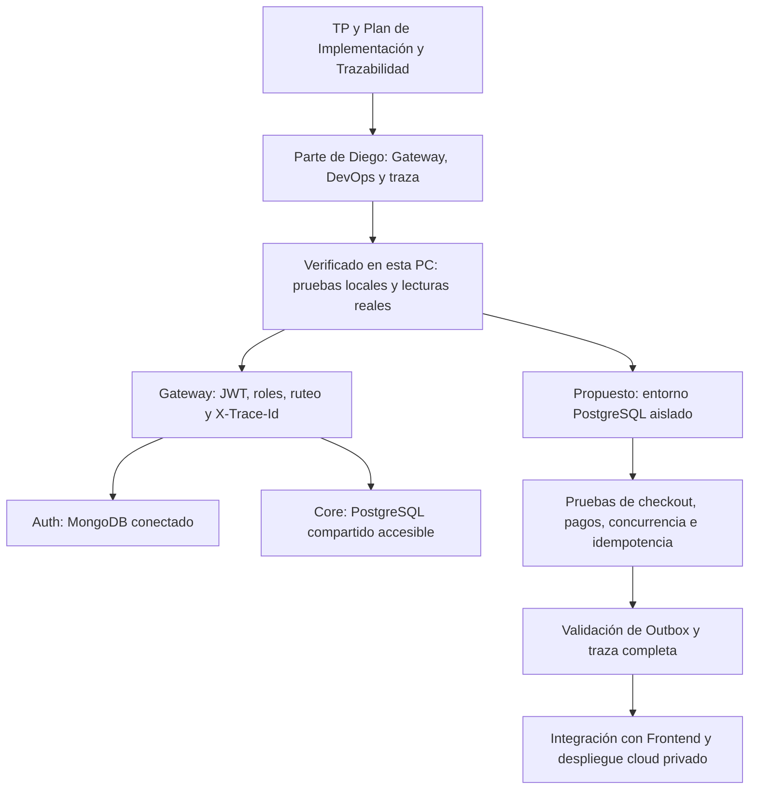
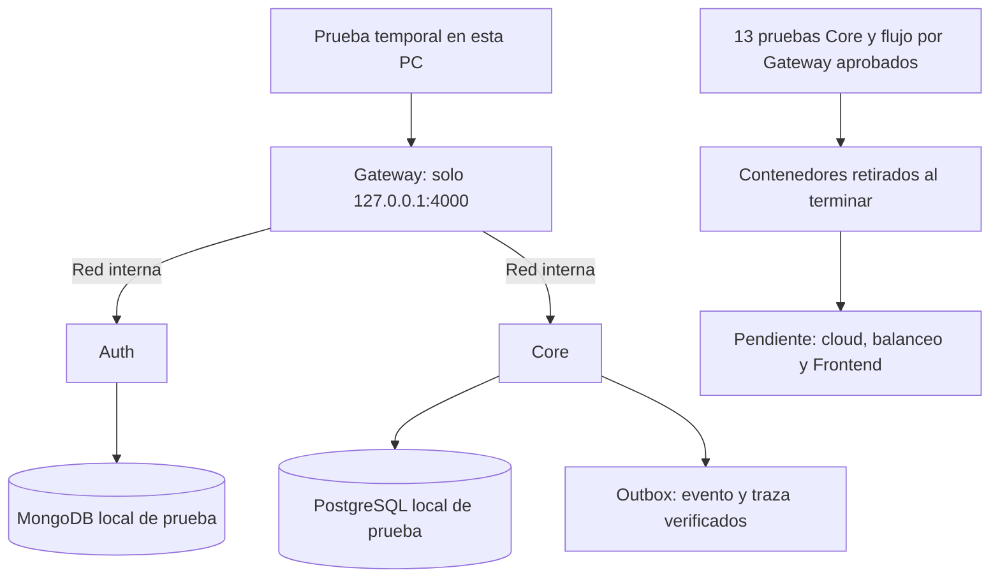

# Punto de control de Diego — 2026-11-01

## Guía de alcance

La referencia de trabajo es el Plan Integral de Implementación y Trazabilidad, respaldado por los TP. El PDF denominado Grupo 9 - TP1 contiene también el TP2. Las decisiones de docs/core-service-decisions.md determinan los contratos actuales del Core. Una diferencia entre documentos e implementación requiere acordar su resolución antes de cambiar comportamiento.

El Plan, sección 5 (página 6), asigna a Diego DevOps, API Gateway y trazabilidad: Dockerfiles y Compose, despliegue cloud con red privada, validación JWT RS256, autorización por ruta, ruteo Auth/Core y X-Trace-Id. Esta preparación local permite verificar esos entregables; no agrega requisitos funcionales al producto.

Diego conserva el control de ramas, commits y push. Cada nuevo lote funcional requiere su aprobación. Para publicar este punto de control, autorizó expresamente al asistente a realizar el commit y el push únicamente a trabajo/diego.

## Estado comprobado de esta PC

- Repositorio: julietaruppertc/acordesmayorista; rama trabajo/diego; commit inicial 8acefac. La relación con origin es la referencia local; no se realizó fetch para afirmar sincronización actual con GitHub.
- Node.js 26.13.0 y npm 11.20.0 instalados. El proyecto exige Node >=24; no se modificaron engines ni lockfiles.
- Dependencias de los tres servicios instaladas con npm ci --no-audit --no-fund.
- Docker no disponible en la terminal ni en la ubicación habitual comprobada. No se instaló ni ejecutó Compose en este paso.
- Se creó services/auth-service/.env desde el archivo local env, sin sobrescribir destinos.
- Se creó services/core-service/.env copiando únicamente DATABASE_URL, DATABASE_SSL y PAYMENT_WEBHOOK_SECRET desde el archivo privado trasladado. No se copiaron variables administrativas adicionales de Supabase.
- La clave privada está presente y corresponde a la clave pública versionada; se verificó criptográficamente sin imprimir las claves.
- .gitignore protege ahora también los dos nombres originales de los archivos trasladados. Se comprobó con git check-ignore la exclusión de estos archivos, los dos .env y la clave privada.
- Los originales se conservaron. No se publicaron credenciales ni tokens.

## Evidencia y trazabilidad

| Entregable de Diego / respaldo | Evidencia de este paso | Límite |
| --- | --- | --- |
| JWT RS256 y roles; D-02 / RNF-04 | Auth: 6 pruebas aprobadas; Gateway: 6 pruebas aprobadas, incluidas autenticación y autorización | Las pruebas locales usan persistencia o servicios simulados; no prueban un login real |
| Ruteo inverso; RES-05 a RES-09 | HTTP 200 en clave pública y catálogo a través de Gateway; Auth conectado a MongoDB y Core listo con PostgreSQL | No prueba separación de servidores cloud de RES-07 |
| Trazabilidad; sección 5 del Plan | X-Trace-Id conservado en respuestas de Gateway, Core y catálogo por Gateway | No se demostró aún una compra completa hasta Outbox |
| Verificación de proceso | Core: 2 pruebas de salud aprobadas; salud de los tres servicios con HTTP 200 | Salud de proceso no equivale a flujo comercial correcto |
| Docker y despliegue cloud; secciones 2, 3 y 5 del Plan | Configuración existente inspeccionada | Pendiente ejecutar Compose y verificar despliegue/red privada |

Comandos de pruebas, desde cada servicio:

```powershell
# services/auth-service
npm.cmd test
# services/api-gateway
npm.cmd test
# services/core-service: solamente salud, sin integración con base
npm.cmd test -- tests/health.test.js
```

La comprobación temporal inició Auth con autoCreate=false y autoIndex=false de Mongoose, sin modificar su código, para impedir creación automática de colecciones o índices. Se ocultó la salida de los servicios y se imprimieron solamente códigos HTTP, estado de conexión y resultado de traza. Se consultaron GET /health de los tres servicios, GET /ready del Core (SELECT 1), GET /auth/public-key y GET /api/products vía Gateway. Todos respondieron 200. Los procesos iniciados se detuvieron al terminar.

Auth directo no devuelve X-Trace-Id en /health; sí lo utiliza en sus logs. El Gateway devuelve su propia cabecera de traza. No se cambió ese comportamiento ni se considera validada aquí la trazabilidad completa de negocio.

No se ejecutaron migraciones, semillas, checkout, webhooks, expiración ni worker contra las bases compartidas. No se ejecutó npm test completo en Core: incluye integración que escribe datos.

## Cambios de este lote

- .gitignore: dos exclusiones específicas para configuración privada trasladada.
- Este documento: registro de alcance, verificaciones, límites y próximos pasos.
- Configuración privada local ignorada: dos .env preparados sin sobrescritura.
- Ninguna modificación de rutas, roles, DTO, estados, errores, firma HMAC ni lógica de negocio.

## Diferencias a acordar, sin implementar en este lote

- README y documentación de Auth atribuyen validación JWT al Core. La integración y código actuales del Core delegan esa validación al Gateway y autorizan mediante identidad propagada. Mantener el contrato vigente y acordar la corrección documental.
- El Plan DEC-09 (página 6) incluye round-robin entre réplicas saludables; el Gateway actual usa un destino por servicio. Es un pendiente de la parte de Diego, no una funcionalidad para agregar durante la preparación local.
- Compose actual no inicia el worker ni el proceso de expiración. Su puesta en marcha debe planificarse con el despliegue y con la responsabilidad del Core de Paz.
- El Plan DEC-08 menciona roles SQL restringidos. Las migraciones revisadas aplican revocaciones y RLS, pero no crean esos roles de servicio. Coordinar con Paz antes de modificar permisos.
- El TTL de 5 minutos está documentado en DEC-MVP-09. El Plan menciona tanto 10 minutos como 5 en su cronograma. Conservar el valor decidido; unificar la explicación de la demo.
- Precios y mínimos mayoristas corresponden al alcance comercial de los TP y requieren confirmar alcance del MVP con Paz y Julieta. No se agregan a la tarea de Diego por inferencia.
- No se encontraron archivos del Frontend en apps/ en esta copia. Coordinar su integración con Camila cuando esté disponible.

## Diagrama de estado y objetivo



El diagrama distingue lo verificado de lo propuesto. El objetivo es demostrar los patrones evaluados sin usar las bases compartidas para pruebas de escritura. Las pruebas del Core no implican asumir su desarrollo funcional.

## Próximo lote propuesto, pendiente de aprobación

Preparar un entorno PostgreSQL local aislado para validación reproducible. Archivos previstos: docker-compose.dev.yml, una plantilla de entorno sin secretos y una guía de ejecución/trazabilidad. Mantener intactos los contratos de Auth, Gateway y Core. El Compose existente conserva su uso hasta acordar la forma de incorporar la variante local.

Primero instalar/verificar Docker, levantar solo la base aislada y comprobar su destino y salud. Después autorizar y ejecutar migraciones y semillas únicamente allí. Verificar checkout exitoso y rollback, 10 compras por una unidad, firmas inválidas, pago aprobado/rechazado/tardío, repetición de paymentId, stock sin negativos y un único evento por pago. Verificar Outbox y expiración sin procesar datos ajenos.

Separar este lote de balanceo cloud, permisos SQL, reglas mayoristas e implementación del Frontend. Cada diferencia requiere una decisión trazable al Plan y al TP correspondiente antes de modificar código.

## Checklist de entregables de Diego

Referencia: Plan, sección 5, página 6; integración y demostraciones de páginas 9 y 10.

- [x] Gateway Express, ruteo Auth/Core, JWT RS256 y autorización por rol: implementados y probados localmente.
- [x] Eliminación de identidad falsificada e inyección de identidad verificada: probado con servicios simulados.
- [x] Generación y propagación de X-Trace-Id: verificado en Gateway y Core.
- [x] Reenvío del webhook sin modificar sus bytes: probado con destino simulado; HMAC pertenece a Core.
- [ ] Construir y ejecutar Dockerfiles y Compose existentes.
- [ ] Verificar despliegue cloud, variables privadas y acceso público exclusivamente al Gateway.
- [ ] Implementar/verificar balanceo entre réplicas saludables previsto en DEC-09, en un lote acordado.
- [ ] Validar con Paz worker y trazabilidad de una compra completa hasta Outbox.
- [ ] Ejecutar con el equipo concurrencia e idempotencia sobre una base aislada.

El Plan menciona jose para JWT; Gateway utiliza jsonwebtoken con RS256. Registrar la diferencia y acordar si la biblioteca es obligatoria antes de reemplazarla. No se modifica en este lote.

## Comandos que Diego puede ejecutar

Desde la raíz del repositorio, en una terminal nueva de PowerShell:

```powershell
node --version
npm.cmd --version
git branch --show-current
git status --short
npm.cmd --prefix services/api-gateway test
npm.cmd --prefix services/auth-service test
npm.cmd --prefix services/core-service test -- tests/health.test.js
```

Resultados comprobados: Gateway 6, Auth 6 y salud de Core 2 pruebas aprobadas. No es necesario iniciar servicios reales. Auth simula persistencia y Gateway simula destinos; no se modifican bases compartidas.

Para estudiar pruebas concretas del Gateway:

```powershell
cd services/api-gateway
node --test --test-name-pattern="restringe ajustes" tests/gateway.test.js
node --test --test-name-pattern="rechaza token" tests/gateway.test.js
node --test --test-name-pattern="webhook" tests/gateway.test.js
cd ../..
```

Verificar exclusión de archivos privados sin imprimir valores:

```powershell
git check-ignore services/auth-service/.env services/core-service/.env shared/keys/private.pem services/auth-service/env services/core-service/acordes-mayorista-supabase-privado.env
```

Las cinco rutas deben aparecer. No ejecutar la suite completa de Core ni migrate, seed, demo:critical, worker o expire-reservations con la configuración de la base compartida.

## Seguridad de red del equipo

Diego rechazó una solicitud del firewall de Windows para acceso desde redes públicas/privadas. No se confirmó el nombre de la aplicación. No se agregaron excepciones al firewall. Las comprobaciones localhost respondieron correctamente; los procesos temporales fueron detenidos y no se encontraron listeners en los puertos 4000, 4001 y 4002 al cerrar la verificación.

Para próximas ejecuciones manuales, preparar el arranque limitado a 127.0.0.1, conservando la conectividad necesaria en Docker. Los entrypoints actuales no fijan host explícito. Es un cambio propuesto, no realizado. Las pruebas del Gateway ya escuchan explícitamente en 127.0.0.1.

## Inicio de preparación cloud — 2026-11-01

Diego eligió comenzar la preparación para Railway manteniendo Atlas y Supabase. Todavía no tiene cuenta/proyecto. Ver docs/railway-deployment.md para topología, configuración por servicio, secretos y comprobaciones. No se crearon recursos ni se desplegó código. Quedan por aprobar adaptaciones de clave privada de Auth, prevención de escrituras durante la primera fase y exclusión de archivos privados del contexto Docker. Worker y expiración deben seguir detenidos sobre la base compartida. Este avance es documental; no acredita todavía despliegue, red privada operativa ni balanceo.

## Preparación de prueba Docker temporal — 2026-11-01

Diego autorizó probar localmente y apagar al terminar. Se agregó docker-compose.test.yml como variante independiente con PostgreSQL y MongoDB locales, red internal sin salida externa, sin cargar .env compartidos y único puerto publicado 127.0.0.1:4000. Se agregó Dockerfile.test al Core y montaje de tests de solo lectura, y se excluyeron archivos privados trasladados del contexto Docker. Guía: docs/docker-temporary-test.md.

Docker Desktop 4.97.0 instalado; CLI Docker 29.9.2. docker compose -f docker-compose.test.yml config --quiet pasó. No se construyeron imágenes ni iniciaron contenedores. WSL estaba ausente; su instalación requiere administrador de Windows (el intento sin elevación UAC falló). Se solicitó instalación con confirmación UAC. Resultado de pruebas integrales pendiente; no equivale a aprobación. No se encontraron listeners en puertos 4000, 4001 ni 4002 al comprobar. No se modificaron las bases compartidas, el código funcional ni el Compose principal. No se hicieron nuevos commits ni push.

Actualización de requisitos: instalación oficial de WSL 2.7.14 completada mediante UAC (código 0). El comando elevado wsl --install --no-distribution terminó con código 0 para habilitar el soporte requerido. El intento de iniciar Docker Desktop no permitió obtener un motor operativo; se solicitó detener Desktop. No se iniciaron contenedores del proyecto. Se requiere reinicio manual de Windows y nueva comprobación del motor antes de ejecutar la prueba; no se reinició el equipo automáticamente.

## Resultado tras reinicio: prueba Docker completada

Se ejecutó y aprobó el entorno de docs/docker-temporary-test.md: construcciones de las cuatro imágenes, salud de ambas bases locales y 13 pruebas del Core aprobadas. scripts/docker-smoke.js verificó por Gateway registro, login real, JWT y permisos, checkout, HMAC, pago y cuatro duplicados, un solo pago/evento en SQL y Outbox procesado conservando traza. Trace: docker-smoke-97914ac5-7048-4a15-a449-56afcd1804e2.

Corrección de red: solo Gateway se conecta a test-entry además de test-backend; Auth, Core, MongoDB y PostgreSQL permanecen solo en la red interna. Único puerto publicado: 127.0.0.1:4000. No se utilizaron las bases compartidas ni se alteraron sus .env. Contenedores retirados al terminar; datos ficticios conservados en volúmenes locales. Pendientes: cloud, balanceo, integración Frontend y validación de RNF. No se hicieron nuevos commits ni push.



## DEC-09: demostración local de balanceo completada

Se implementó el pool opcional CORE_SERVICE_URLS con round-robin, sondeo /ready y exclusión/recuperación de destinos. El modo CORE_SERVICE_URL existente se conserva. Sin destinos: 502 UPSTREAM_UNAVAILABLE; no se reintentan compras ni pagos. No cambian rutas, DTO, roles ni lógica de Auth/Core.

Ver docs/gateway-balance-demo.md: Gateway 10 pruebas aprobadas, Docker con dos Core sobre el mismo PostgreSQL local, alternancia A/B, caída de A, recuperación y caída de ambas verificadas. También pasó la compra integrada, HMAC, duplicados y Outbox con el pool habilitado. Contenedores retirados al finalizar. No se acredita carga de 250 usuarios, separación física ni cloud. Balanceo del Core demostrado localmente; Auth continúa con un destino. Cambios sin commit/push.

## Preparación de integración a main

Diego autorizó explícitamente publicar este lote en main para que Camila pueda tomarlo. Esto reemplaza, para esta publicación concreta, la restricción previa de trabajar y publicar solo en trabajo/diego. Se agregó docs/frontend-handoff.md y se aclaró el estado no desplegado de Railway. No se incorporan credenciales ni archivos privados. La publicación requiere pruebas y revisión del contenido; cloud, Frontend real y RNF siguen pendientes.
