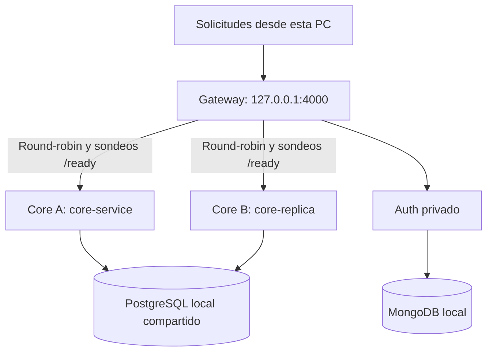

# DEC-09 — Demostración local de balanceo

## Alcance

El Plan Integral de Implementación y Trazabilidad, DEC-09 y tareas de Diego en página 6, prevé descubrimiento por DNS interno y reparto round-robin entre réplicas saludables. Esta implementación demuestra el patrón con dos Core y unas pocas solicitudes en Docker. No acredita 250 usuarios, rendimiento, disponibilidad, múltiples hosts físicos ni despliegue cloud. Auth sigue con un solo destino.

## Funcionamiento y contratos conservados

- CORE_SERVICE_URL conserva el modo anterior con un solo destino, sin sondeo adicional.
- CORE_SERVICE_URLS habilita el modo de pool y tiene prioridad para el ruteo al Core. Es una lista de URLs HTTP/HTTPS base separadas por comas. Se rechazan URLs con credenciales, rutas o consultas; se eliminan duplicados.
- El Gateway consulta GET /ready periódicamente. El Plan menciona /health; se usa el endpoint de readiness ya existente porque comprueba también PostgreSQL con SELECT 1. /health conserva su función de vida del proceso. No cambian las rutas externas ni el Core.
- Solo respuestas 2xx del sondeo habilitan la réplica; timeout, fallo de red o respuesta no exitosa la excluyen. Las réplicas comienzan excluidas hasta el primer sondeo. El Gateway puede responder /health aun sin Core disponibles.
- CORE_HEALTH_INTERVAL_MS: 5000 por defecto. CORE_HEALTH_TIMEOUT_MS: 1000 por defecto. Ambos deben ser enteros positivos hasta 60000 ms. La demo usa 1000/500.
- Los sondeos son paralelos con timeout; no se solapan rondas. Se detienen al cerrar Gateway.
- Cada solicitud nueva se asigna al siguiente destino saludable. Un fallo de transporte del proxy excluye ese destino hasta que un sondeo lo habilite de nuevo.
- Un fallo entre el sondeo y la solicitud todavía puede producir 502. La detección no es instantánea ni garantiza ausencia total de errores durante una caída.
- Sin destinos disponibles se conserva HTTP 502 con error UPSTREAM_UNAVAILABLE y traza. La lógica no cambia roles, JWT, estados, DTO ni respuestas de negocio del Core.
- No hay reintentos automáticos: un checkout o pago podría haber sido procesado aunque se pierda su respuesta. La solicitud fallida no se repite en otra réplica.
- CORE_BALANCE_LOG=true habilita logs de destino y X-Trace-Id para la demostración. No imprime tokens, cuerpos ni secretos. Está desactivado por defecto y no agrega cabeceras al contrato externo.
- Ambas réplicas usan el mismo PostgreSQL local; no se copia el stock en bases independientes.



## Archivos

- services/api-gateway/src/corePool.js: selección y sondeos.
- services/api-gateway/src/app.js: proxy por destino, exclusión por fallo y respuesta cuando no hay réplicas.
- services/api-gateway/src/server.js: variables y ciclo de vida.
- services/api-gateway/.env.example: configuración opcional.
- services/api-gateway/tests/balance.test.js: pruebas con servidores locales simulados.
- docker-compose.test.yml: réplica adicional solo bajo perfil balance, sin cambios a docker-compose.yml.
- docker-compose.balance.yml: activa el pool y logs exclusivamente en la variante de prueba.
- scripts/docker-balance-demo.js: levanta el entorno aislado, comprueba los casos y ejecuta down en finally. Conserva volúmenes locales.

## Repetir

Desde la raíz con Docker Desktop iniciado. No combinar el override con docker-compose.yml: usar solo la variante aislada que se indica.

```powershell
npm.cmd --prefix services/api-gateway test
docker compose -f docker-compose.test.yml -f docker-compose.balance.yml --profile balance config --quiet
docker compose -f docker-compose.test.yml -f docker-compose.balance.yml --profile balance build core-service auth-service api-gateway
node scripts/docker-balance-demo.js
```

En una terminal que todavía no tenga Docker en PATH:

```powershell
$env:DOCKER_BIN = 'C:/Program Files/Docker/Docker/resources/bin/docker.exe'
node scripts/docker-balance-demo.js
```

El script usa migraciones/semillas exclusivamente en el PostgreSQL del proyecto acordes-prueba y repite docker-smoke.js, por lo que crea datos ficticios de compra. Hay seis contenedores durante la demo, frente a cinco en la prueba anterior. Las bases y ambos Core no publican puertos. Solo Gateway tiene la red de entrada y puerto loopback.

No cerrar a la fuerza el proceso mientras ejecuta: finally retira los contenedores. Si se interrumpe externamente, ejecutar manualmente:

```powershell
docker compose -f docker-compose.test.yml -f docker-compose.balance.yml --profile balance down
```

Cerrar Docker Desktop después de comprobar el listado vacío. No usar down -v para apagar: eso elimina datos de prueba y no es necesario.

## Evidencia obtenida

- Gateway: 10 pruebas aprobadas (6 existentes y 4 nuevas).
- Se probó alternancia, bytes/traza/firma conservados, sondeo periódico, recuperación, falta de destinos, timeout y un POST con fallo de transporte que no se reenvía a otra réplica saludable.
- Docker: seis consultas alternaron core-service, core-replica, core-service, core-replica, core-service, core-replica.
- Tras detener Core A: seis consultas HTTP 200 solo en Core B.
- Tras iniciar Core A: volvió la alternancia A/B.
- Con el pool habilitado, docker-smoke.js pasó registro, login RS256 real, permisos, checkout, HMAC, pago y cuatro duplicados, un solo pago/evento en SQL y Outbox procesado.
- Traza de integración: docker-smoke-282e8250-42cf-4d31-b695-e23ab50e66a0.
- Ambas réplicas detenidas: seis respuestas HTTP 502 controladas.
- Demo terminada con PASS y cero contenedores tras down; se solicitó detener Docker Desktop.
- No se utilizaron Atlas ni Supabase. No se ejecutaron pruebas de carga ni se modificó código funcional del Core/Auth.

## Pendientes fuera de este lote

Cloud, integración con Frontend, operación continua del worker, RNF de carga/disponibilidad y revisión de elección de biblioteca JWT. No confundir demostrar dos procesos con cumplir separación física de servidores del despliegue final. Las nuevas variables son opcionales; Camila conserva el mismo contrato HTTP.
