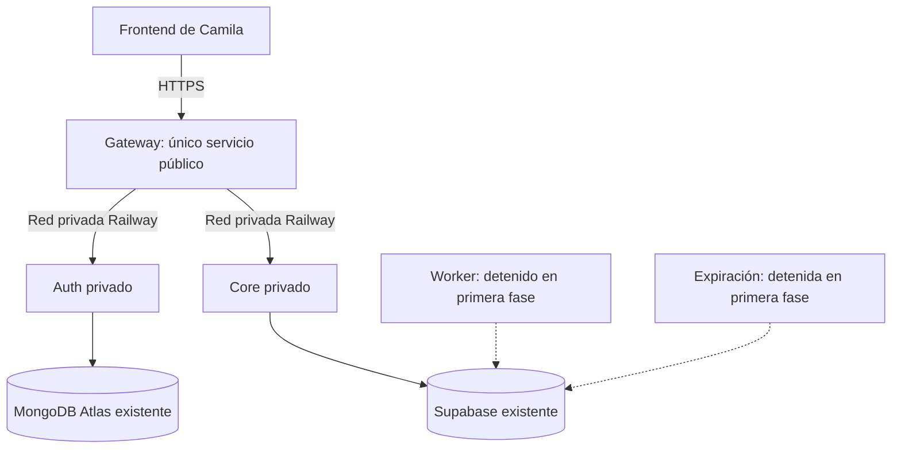

# Railway — alternativa cloud pendiente (no desplegada)

Estado: preparado como guía, no ejecutado. Fecha: 2026-11-01. Diego informó que todavía no tiene cuenta ni proyecto Railway. No se crearon recursos, contrataron planes, cargaron secretos ni modificaron servicios.

## Estado de esta alternativa

Esta guía conserva una propuesta, no una plataforma contratada ni seleccionada definitivamente. Durante la evaluación se encontró que Railway tenía pausadas las altas de cuentas; comprobar su estado oficial antes de retomar. El camino ejecutado y validado es Docker local aislado. Los planes, créditos y disponibilidad deben revisarse al momento de contratar. No hay cuenta/proyecto cloud ni credenciales cargadas por esta tarea.

La exclusión de los archivos privados trasladados en .dockerignore ya se completó durante la preparación local. Los demás bloqueos de esta guía son propuestas cloud, no cambios aplicados ni requisitos para iniciar el Compose de prueba.

## Alcance y referencia del TP

El Plan Integral, página 6, asigna a Diego Dockerfiles, despliegue cloud con variables y red privada, Gateway, JWT, permisos y X-Trace-Id. Página 4: solo Gateway público; Auth y Core privados. DEC-MVP-13 del Core conserva Supabase como PostgreSQL. MongoDB Atlas conserva los usuarios de Auth. Esta guía no reemplaza los contratos de docs/core-service-decisions.md ni incorpora nuevas reglas de negocio.

## Topología objetivo



La red privada Railway protege el tráfico entre aplicaciones dentro del mismo proyecto y entorno. Las conexiones hacia Atlas y Supabase siguen siendo conexiones externas con sus propios controles y cifrado; no pasan a ser privadas por desplegar las aplicaciones en Railway.

## Primera fase: cuenta y configuración, sin publicación automática

1. Crear cuenta en https://railway.com/ usando una identidad propia. Revisar permisos antes de autorizar GitHub. El repositorio pertenece a julietaruppertc; no asumir que Diego tiene autorización para instalar una integración en esa cuenta. Si el repositorio no aparece, coordinar el acceso con Julieta sin compartir credenciales.
2. Revisar el plan, los créditos disponibles y el control de gasto del dashboard antes de desplegar. No asumir gratuidad permanente ni que un crédito inicial cubre todos los servicios.
3. Crear un proyecto denominado acordes-mayorista y un entorno de desarrollo. Mantener las aplicaciones en el mismo proyecto y entorno para comunicación privada.
4. Crear servicios vacíos inicialmente. Evitar el despliegue automático desde GitHub hasta completar puertos, secretos y restricciones. Elegir la rama trabajo/diego para esta preparación; no publicar main ni cambiar la rama del equipo sin acuerdo.
5. Preparar Auth y Core sin dominio público ni proxy TCP. Mantener Gateway también privado hasta resolver el bloqueo de escrituras de la siguiente sección.

## Configuración propuesta por servicio

Confirmar los campos del dashboard al desplegar. El Compose local no se aplica automáticamente a Railway.

| Servicio | Raíz de construcción | Dockerfile | Variables de puerto | Salud | Exposición inicial |
| --- | --- | --- | --- | --- | --- |
| auth-service | raíz del repositorio | services/auth-service/Dockerfile | PORT=4001 | /health | privada |
| core-service | services/core-service | Dockerfile | CORE_PORT=4002 y PORT=4002 | /ready | privada |
| api-gateway | raíz del repositorio | services/api-gateway/Dockerfile | GATEWAY_PORT=4000 y PORT=4000 | /health | privada hasta completar controles |

Auth y Gateway requieren contexto desde la raíz porque copian shared/keys/public.pem. Core utiliza contexto propio. Configurar la ruta Dockerfile correspondiente en Railway; para las construcciones desde raíz puede usarse la variable RAILWAY_DOCKERFILE_PATH según la documentación vigente del proveedor.

Los valores PORT se fijan explícitamente para coincidir con los puertos que lee cada aplicación. No cambiar contratos HTTP ni rutas para adaptar el proveedor. Verificar escucha y conectividad interna al ejecutar.

## Variables y secretos: no copiar sus valores a esta guía

Auth:

- NODE_ENV=production, PORT=4001 y JWT_EXPIRES_IN=1h.
- MONGO_URI: secreto exclusivo de Auth, cargado mediante el dashboard por una persona autorizada.
- Clave privada RSA: pendiente de mecanismo seguro de inyección. El código actual lee shared/keys/private.pem y la imagen no contiene ese archivo. No desplegar login como funcional hasta resolverlo.

Core:

- NODE_ENV=production, CORE_PORT=4002, PORT=4002 y DATABASE_SSL=true para Supabase.
- DATABASE_URL y PAYMENT_WEBHOOK_SECRET: secretos exclusivos del Core; no copiar todas las variables administrativas de Supabase.
- RESERVATION_TTL_MINUTES=5, conforme DEC-MVP-09 vigente.
- No incluir comandos migrate o seed en inicio ni predeploy contra la base compartida.

Gateway:

- NODE_ENV=production, GATEWAY_PORT=4000 y PORT=4000.
- AUTH_SERVICE_URL: URL HTTP del dominio privado real de Auth, puerto 4001.
- CORE_SERVICE_URL: URL HTTP del dominio privado real de Core, puerto 4002.
- CORS_ORIGIN: origen exacto acordado con Camila. Confirmar su puerto de desarrollo; no asumir 3000 por utilizar Vite. CORS no sustituye autenticación ni bloquea clientes de consola.
- No necesita MONGO_URI, DATABASE_URL, clave privada ni PAYMENT_WEBHOOK_SECRET.

Usar dominios internos o referencias a RAILWAY_PRIVATE_DOMAIN de cada servicio. No usar localhost para conectar contenedores diferentes. No imprimir secretos en consola ni incluirlos en Dockerfile, argumentos de build, capturas, documentos o Git. Preferir variables selladas para los secretos cuando el proveedor lo permita.

## Bloqueos técnicos antes de publicar

1. Inyección de clave privada: proponer soporte de secreto de entorno en el arranque de Auth, con validación y sin logs del valor, conservando el archivo local como alternativa. Requiere revisar con Julieta el archivo y comportamiento exactos antes de implementar.
2. Cero escrituras en primera comprobación: el Gateway actual permite registro, checkout, ajustes y webhook. No publicar ese comportamiento contra bases compartidas bajo la etiqueta de solo lectura. Proponer modo temporal que admita únicamente salud, clave pública y catálogo, rechazando el resto antes del proxy. Documentar cómo se desactiva solo al disponer de datos de desarrollo aislados.
3. MongoDB: la conexión Mongoose puede crear colecciones/índices automáticamente. Proponer opciones explícitas desactivadas para esta fase; las comprobaciones anteriores ya las desactivaron temporalmente sin modificar código.
4. Contexto Docker revisado: services/auth-service/env y los archivos privados trasladados ya están excluidos mediante .dockerignore. Conservar esa exclusión al preparar cualquier despliegue.
5. Mantener worker y expiración sin desplegar o detenidos: ambos escriben y pueden procesar filas ajenas en la base compartida.

Estas adaptaciones constituyen el siguiente lote funcional: presentar archivos concretos, comportamiento conservado y pruebas, y esperar aprobación de Diego antes de implementarlo. No se han aplicado como parte de esta guía.

## Comprobaciones posteriores, todavía pendientes

- Construcción exitosa y logs sin secretos.
- Auth /health conectado a Atlas; Core /ready con SELECT 1 exitoso.
- Login real pendiente de fase de datos aislados; salud no demuestra que la clave de firma esté cargada.
- Solo Gateway con dominio público HTTPS; sin dominios públicos ni TCP proxies de Auth/Core.
- En modo de solo lectura: GET /health, GET /auth/public-key y GET /api/products por Gateway.
- X-Trace-Id enviado por cliente conservado en respuesta y en el salto hacia Core.
- Rutas de escritura rechazadas por Gateway sin alcanzar destinos.
- No ejecutar pagos, checkout, worker, expiración, migraciones ni semillas hasta disponer de base aislada.

Ejemplos para cuando exista una URL real, desde PowerShell:

```powershell
$gatewayUrl = 'https://REEMPLAZAR-POR-DOMINIO-REAL'
curl.exe -i "$gatewayUrl/health"
curl.exe -i "$gatewayUrl/auth/public-key"
curl.exe -i -H 'X-Trace-Id: diego-cloud-lectura-001' "$gatewayUrl/api/products"
```

No ejecutar estos ejemplos con el marcador; no existe una URL desplegada todavía.

## Fases siguientes

- Aislar datos de desarrollo para pruebas de escritura.
- Coordinar worker y expiración con Paz; validar traza hasta Outbox.
- Integrar Frontend con Camila: URL, CORS, token, expectedVersion y errores conforme contratos vigentes.
- Completar balanceo y salud de réplicas DEC-09; un despliegue de una instancia no acredita ese requisito.
- Documentar resultados efectivos, evidencia y pendientes sin marcar como verificado lo que solo está configurado.

## Fuentes oficiales consultadas

- https://docs.railway.com/deployments/monorepo
- https://docs.railway.com/variables
- https://docs.railway.com/networking/private-networking
- https://docs.railway.com/pricing/plans
- https://docs.railway.com/deployments/healthchecks

La documentación consultada de Config as Code marca railway.json/railway.toml como deprecados para nuevos usos. Esta preparación usa una guía explícita del dashboard y no introduce archivos legacy de despliegue. Confirmar soporte vigente antes de automatizar con Infrastructure as Code.
